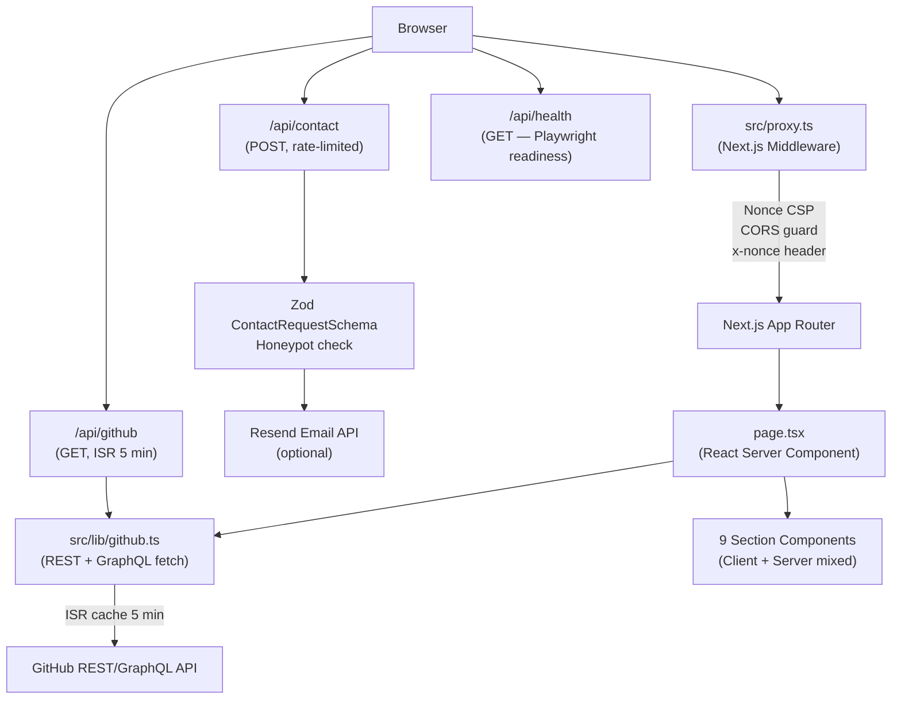
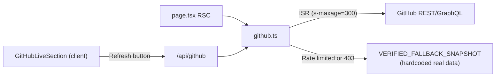

# ARCHITECTURE.md — BAJAJ.OS Portfolio

## Overview

BAJAJ.OS is a single-page Next.js 16 (App Router) application with a small backend surface. It is designed for static hosting on Vercel with a handful of server-rendered dynamic routes.



## Request Lifecycle

1. **Middleware** (`src/proxy.ts`) runs on every non-static request:
   - API routes: CORS origin check; `Cache-Control: no-store`
   - Page routes: generates a per-request UUID → base64 nonce; sets `Content-Security-Policy` header with `'nonce-<n>'` and `'strict-dynamic'`; forwards `x-nonce` header to the RSC render

2. **Layout RSC** (`src/app/layout.tsx`): reads `x-nonce` from request headers; passes nonce to `AppProviders` (client) for `MotionConfig` and inline scripts

3. **Page RSC** (`src/app/page.tsx`): calls `getGitHubOverview()` server-side; receives GitHub data as a prop; passes it to `GitHubLiveSection` (client component)

4. **Client components**: hydrate on the browser; Lenis smooth scroll initialises; GSAP ScrollTrigger syncs with Lenis RAF; `IntersectionObserver` tracks active section

## Data Flow — GitHub Live



The fallback snapshot contains verified live data from `bajajaarna4-bit`'s public GitHub profile as of session date. If the token is missing or rate-limited, the site renders the snapshot rather than breaking.

## Security Architecture

See [SECURITY.md](./SECURITY.md) for the full security hardening summary.

Key primitives:
- **Nonce-based CSP**: every page load gets a fresh UUID nonce; `'strict-dynamic'` propagates it to dynamically-inserted scripts
- **No `unsafe-eval` in production**: Three.js and R3F compile shader programs via WebGL (not JS eval), so this is achievable
- **CORS guard in middleware**: `/api/` routes reject cross-origin requests that don't match `SITE_URL` or the request origin
- **Zod at every boundary**: contact route, GitHub route, env parsing — all validated before use
- **Rate limiting**: sliding-window in-memory (`src/lib/rate-limit.ts`); contact: 5/15min; GitHub: 30/min
- **Server-only env**: `src/lib/env.ts` imports `server-only`; Zod enforces shape at runtime

## Component Architecture

```
AppProviders (client)
├── OSContext — pointer, active section, command palette open state
├── MotionConfig (nonce, reducedMotion="user")
├── Lenis smooth scroll (disabled for reduced-motion or coarse pointer)
└── GSAP ScrollTrigger sync

page.tsx (RSC)
└── ErrorBoundary (×9)
    ├── BootSequence (client)
    ├── MenuBar (client)
    ├── MagneticDock (client)
    ├── CommandPalette (client)
    ├── HeroSection (client) ← JarvisOrbCanvas (dynamic, ssr:false)
    ├── PhilosophySection (client) ← GSAP ScrollTrigger
    ├── GitHubLiveSection (client) ← DraggableWindow
    ├── FeaturedProjectSection (client) ← DraggableWindow
    ├── AiLabSection (client)
    ├── StartupIdeaSection (client)
    ├── PodcastSection (client) ← Web Audio API
    ├── SecurityLabSection (client) ← local simulator only
    └── ContactSection (client) ← /api/contact
```

## Performance Strategy

| Concern | Approach |
|---|---|
| Initial JS bundle | 3D Canvas loaded via `next/dynamic({ ssr: false })` |
| Images | `next/image` with `sizes` + `avatars.githubusercontent.com` remote pattern |
| Fonts | `@fontsource-variable/*` (offline, no Google Fonts network request) |
| ISR | GitHub data: `s-maxage=300` on both page RSC and `/api/github` |
| CLS prevention | JarvisOrb Suspense fallback preserves layout dimensions |
| Mobile | dpr cap `[1,1.5]`, reduced geometry on `hardwareConcurrency ≤ 4` |
| Scroll perf | GSAP `will-change: transform` only during animation; ScrollTrigger `invalidateOnRefresh` |

## Deployment

**Target:** Vercel (Edge Network + Node.js runtime)

- `ƒ /` — dynamic (server renders per request for fresh nonce)
- `ƒ /api/contact` — dynamic (POST, rate-limited, Resend)
- `ƒ /api/github` — dynamic (ISR with Cache-Control header)
- `ƒ /api/health` — dynamic (Playwright readiness)
- `○ /robots.txt`, `○ /sitemap.xml` — static prerendered

Build command (in `package.json`): `next build --webpack`
